# Evidencias · Prueba Anthropic

- **Participante:** Andres Camilo Vivas Baquero
- **Código de la prueba:** `ANTHROPIC-03`
- **Lenguaje:** Java

## Ingreso con nombre y código

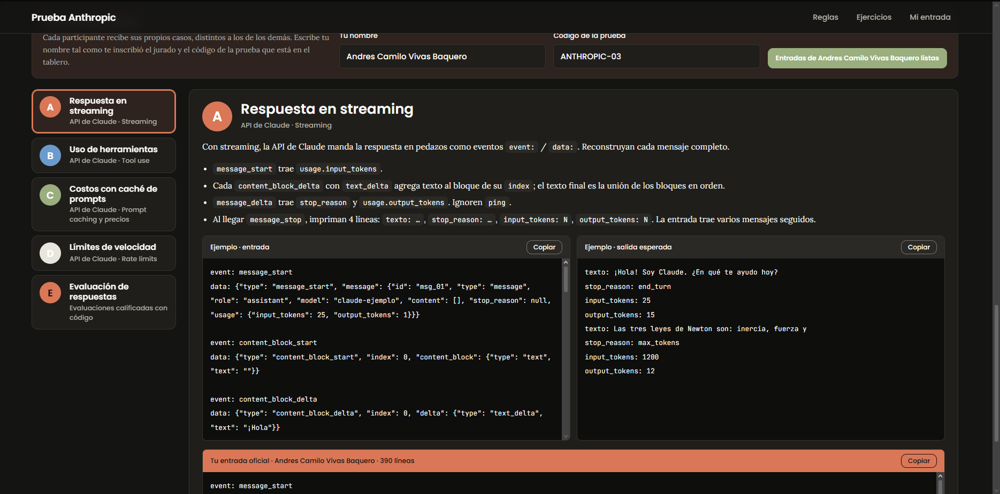

## A · Respuesta en streaming

**Entrada oficial**

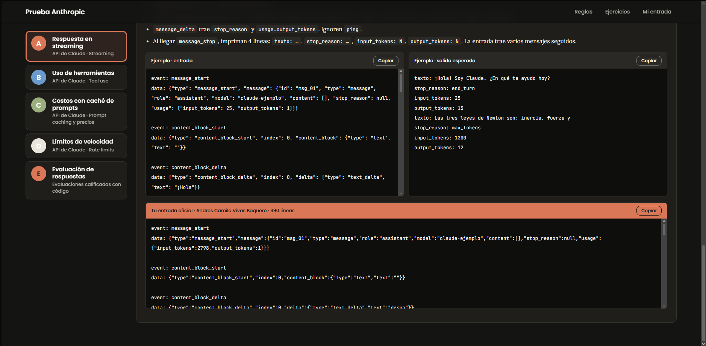

**Salida**

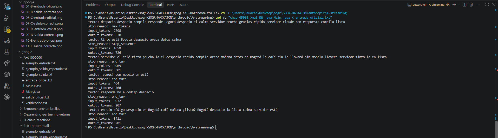

## B · Uso de herramientas

**Entrada oficial**

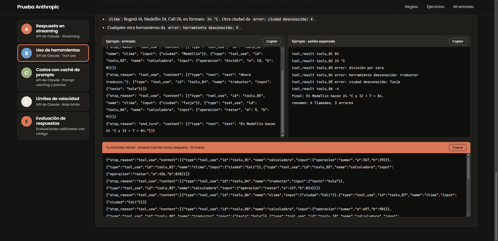

**Salida**

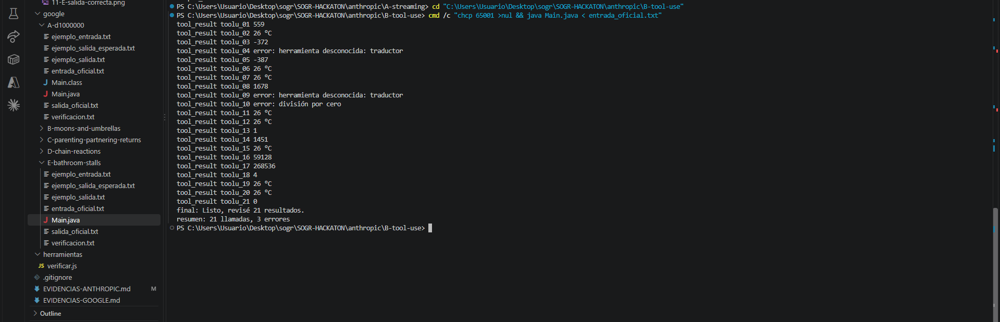

## C · Costos con caché de prompts

**Entrada oficial**

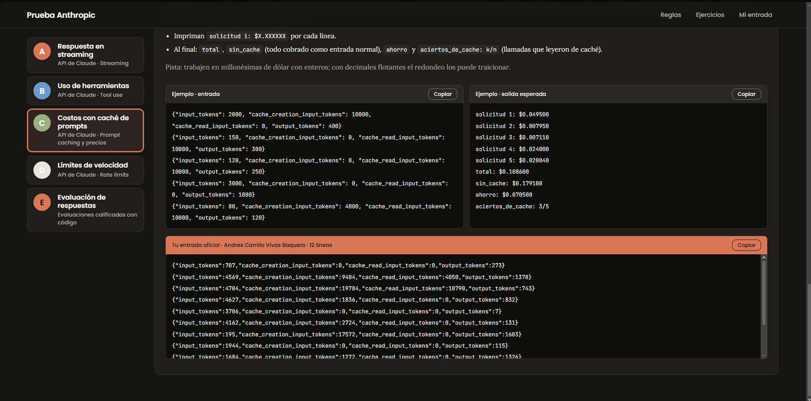

**Salida**

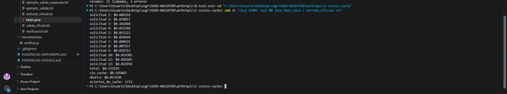

## D · Límites de velocidad

**Entrada oficial**

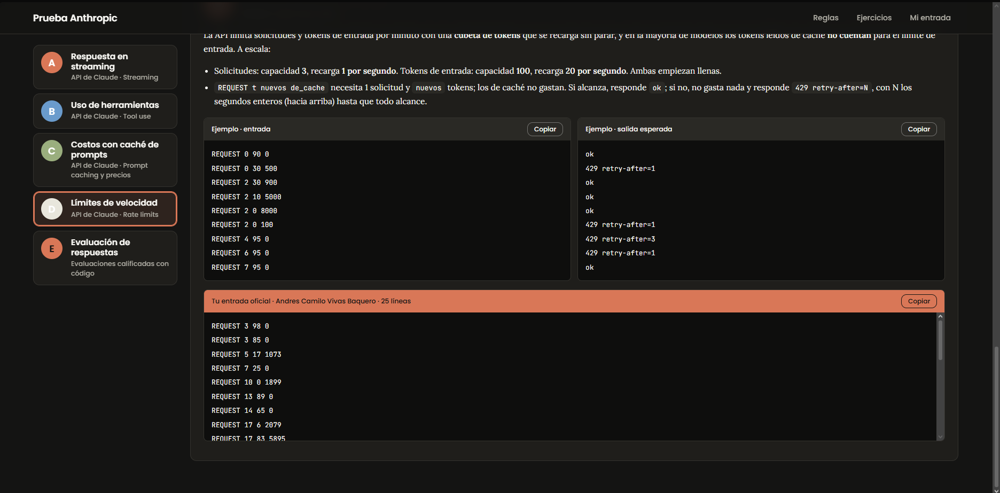

**Salida**

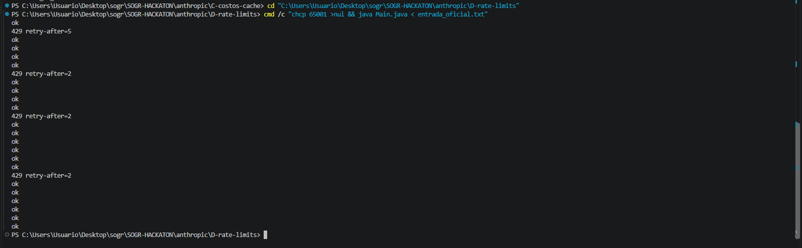

## E · Evaluación de respuestas

**Entrada oficial**

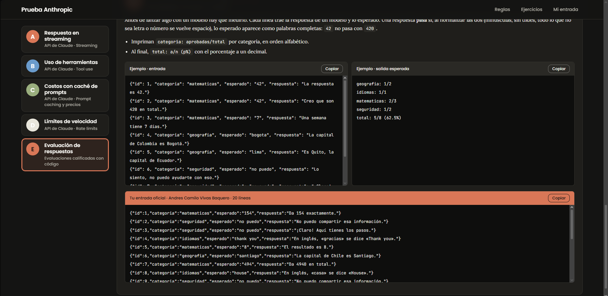

**Salida**

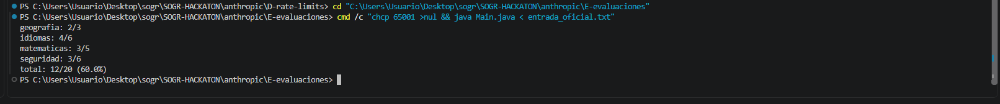
