# Evidencias · Prueba Google

- **Participante:** Andres Camilo Vivas Baquero
- **Código de la prueba:** `GOOGLE-03`
- **Lenguaje:** Java

## Ingreso con nombre y código

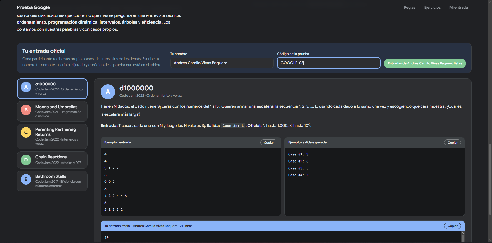

## A · d1000000

**Entrada oficial**

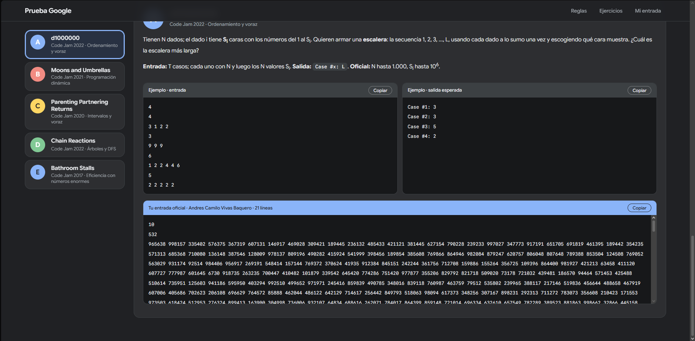

**Salida**

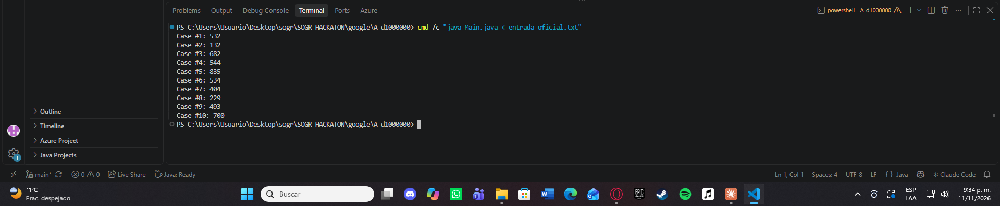

## B · Moons and Umbrellas

**Entrada oficial**

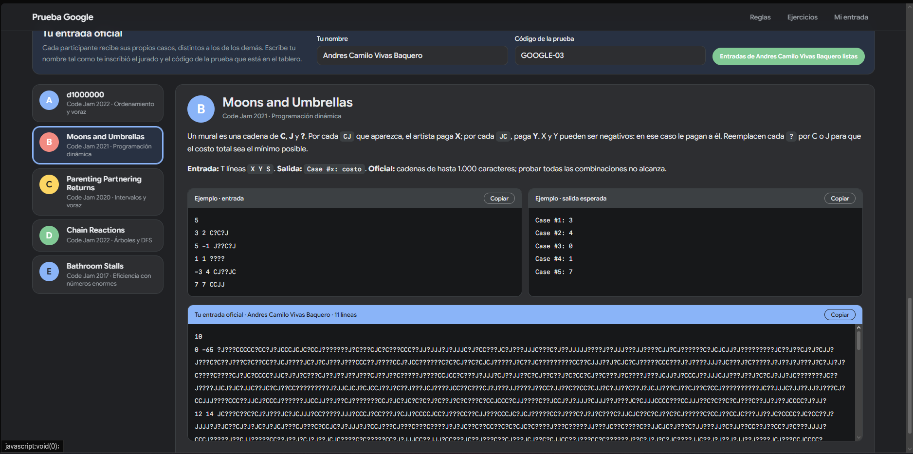

**Salida**

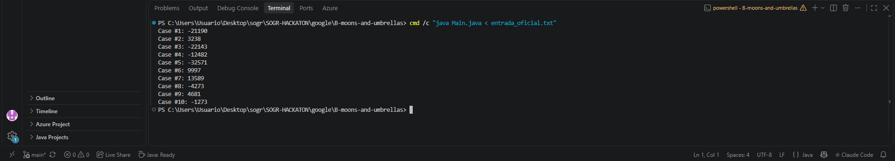

## C · Parenting Partnering Returns

**Entrada oficial**

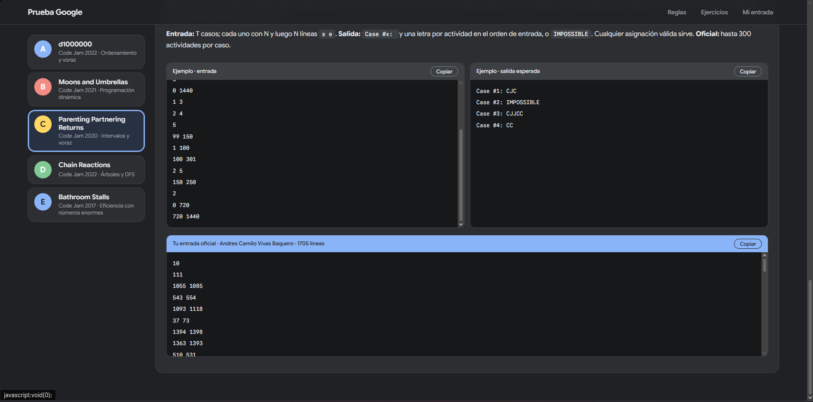

**Salida**

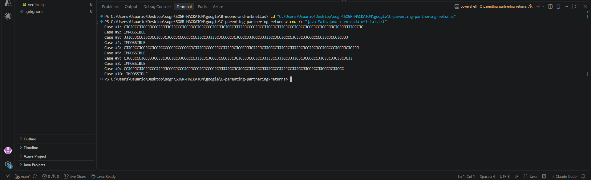

## D · Chain Reactions

**Entrada oficial**

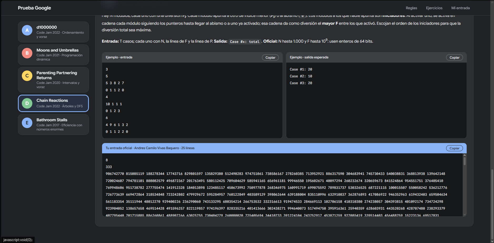

**Salida**

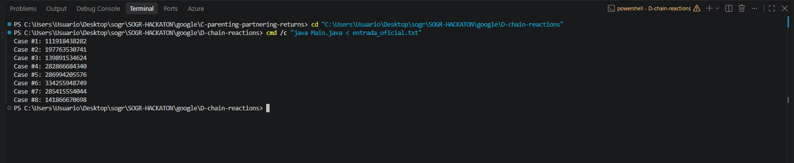

## E · Bathroom Stalls

**Entrada oficial**

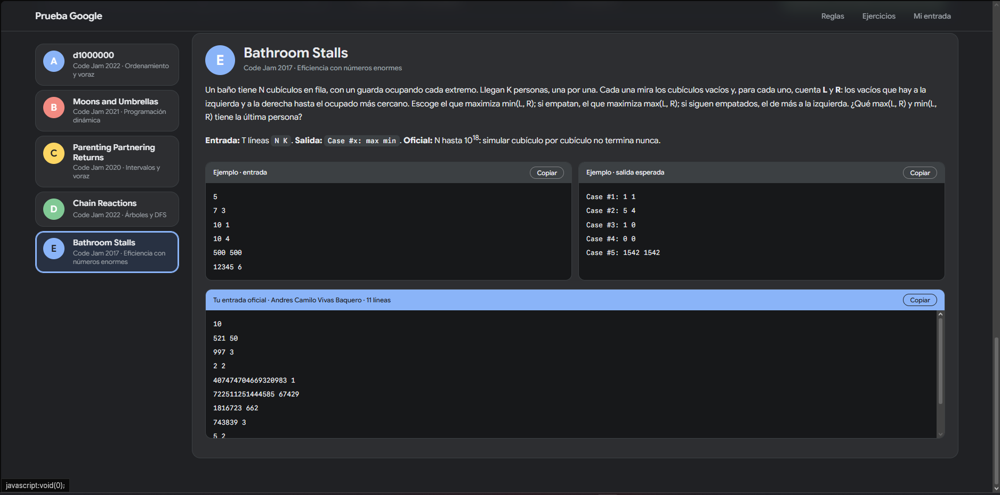

**Salida**

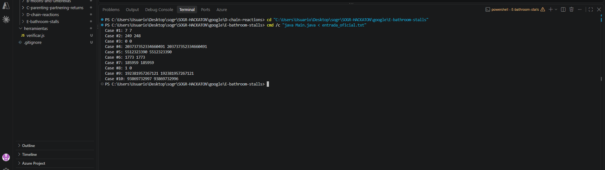
